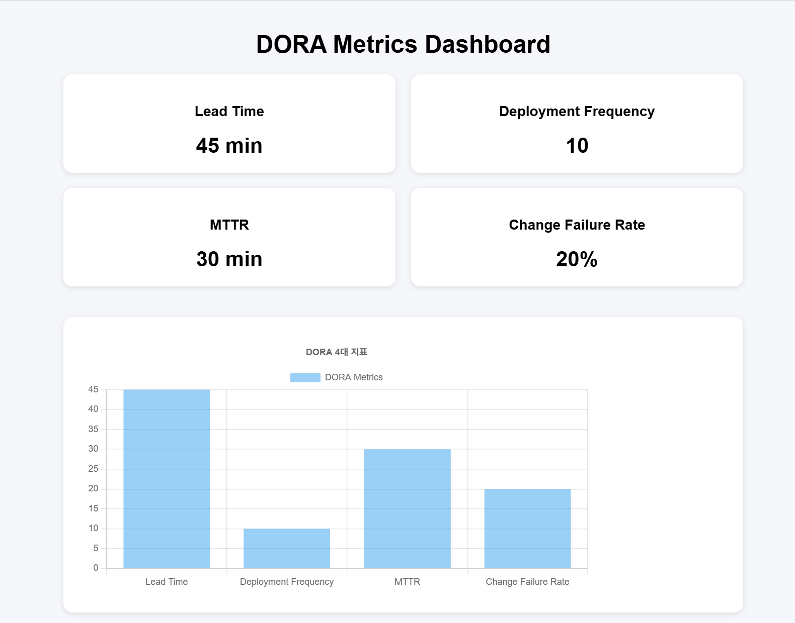

# DORA 메트릭 수집 자동화

GitHub Actions를 활용하여 DORA 4대 지표를 자동으로 수집하고,
수집 결과를 JSON 파일 및 주간 리포트 형태로 저장하며,
Chart.js 기반 대시보드로 시각화하는 프로젝트입니다.

---

## 1. 프로젝트 목표

DevOps 성과 측정을 위해 사용되는 DORA 4대 지표를
GitHub Actions 기반으로 자동 수집하도록 구성했습니다.

수집 대상은 다음과 같습니다.

- Lead Time
- Deployment Frequency
- MTTR
- Change Failure Rate

또한 수집 결과를 JSON 파일로 저장하고,
주간 리포트를 자동 생성하도록 구성했습니다.

---

## 2. 프로젝트 구조

    .
    ├─ .github/
    │  └─ workflows/
    │     └─ dora-metrics.yml
    │
    ├─ scripts/
    │  ├─ calculate_dora.py
    │  └─ generate_weekly_report.py
    │
    ├─ dashboard/
    │  └─ index.html
    │
    ├─ reports/
    │  └─ weekly-report.md
    │
    ├─ images/
    │  └─ dora-dashboard.png
    │
    ├─ dora-metrics.json
    └─ README.md

---

## 3. DORA 4대 지표

### 3-1. Lead Time

코드 변경 이후 배포가 완료되기까지 걸리는 시간을 의미합니다.

본 프로젝트에서는 GitHub Actions 실행 시간을 기반으로
평균 Lead Time을 계산합니다.

### 3-2. Deployment Frequency

일정 기간 동안 배포가 얼마나 자주 이루어졌는지를 의미합니다.

본 프로젝트에서는 최근 7일 동안 성공한
GitHub Actions 실행 횟수를 기준으로 계산합니다.

### 3-3. MTTR

MTTR은 Mean Time To Recovery의 약자로,
장애 또는 배포 실패가 발생한 이후 정상 상태로 복구되기까지
걸린 평균 시간을 의미합니다.

본 프로젝트에서는 실패한 Workflow 이후
다음 성공 Workflow까지의 시간을 기준으로 계산합니다.

### 3-4. Change Failure Rate

전체 배포 중 실패한 배포의 비율을 의미합니다.

계산식은 다음과 같습니다.

    Change Failure Rate
    = 실패한 배포 횟수 / 전체 배포 횟수 × 100

---

## 4. GitHub Actions 자동화

DORA 메트릭 수집은
`.github/workflows/dora-metrics.yml`
파일을 통해 자동으로 실행됩니다.

Workflow는 다음 조건에서 실행됩니다.

### main 브랜치 Push

main 브랜치에 새로운 코드가 Push되면
Workflow가 자동 실행됩니다.

    on:
      push:
        branches:
          - main

### 수동 실행

GitHub Actions 페이지에서
`Run workflow` 버튼을 이용하여 직접 실행할 수 있습니다.

    workflow_dispatch:

### 주간 자동 실행

매주 월요일 UTC 00:00에 자동 실행됩니다.

한국 시간 기준으로는 매주 월요일 오전 9시에 실행됩니다.

    schedule:
      - cron: '0 0 * * 1'

---

## 5. DORA 메트릭 수집 과정

전체 자동화 과정은 다음과 같습니다.

    GitHub Push 또는 Schedule 실행
            ↓
    GitHub Actions 실행
            ↓
    calculate_dora.py 실행
            ↓
    GitHub Actions 실행 기록 조회
            ↓
    DORA 4대 지표 계산
            ↓
    dora-metrics.json 생성
            ↓
    generate_weekly_report.py 실행
            ↓
    weekly-report.md 생성
            ↓
    Artifact 저장

---

## 6. JSON 결과 저장

수집한 DORA 메트릭은
`dora-metrics.json`
파일로 생성됩니다.

예시는 다음과 같습니다.

    {
        "generated_at": "2026-10-15T03:00:00+00:00",
        "period": "last_7_days",
        "lead_time_minutes": 0.35,
        "deployment_frequency": 4,
        "mttr_minutes": 12.5,
        "change_failure_rate": 20.0
    }

GitHub Actions 실행 후
해당 JSON 파일은 Artifact로 저장됩니다.

---

## 7. 주간 리포트 자동 생성

`generate_weekly_report.py`를 이용하여
DORA 메트릭 결과를 기반으로
주간 리포트를 자동 생성합니다.

생성 파일:

    reports/weekly-report.md

주간 리포트에는 다음 내용이 포함됩니다.

- Lead Time
- Deployment Frequency
- MTTR
- Change Failure Rate
- 측정 기간
- 리포트 생성 시각

주간 리포트 역시
GitHub Actions Artifact에 함께 저장됩니다.

---

## 8. Artifact 저장

GitHub Actions 실행 후
다음 파일을 Artifact로 저장합니다.

    dora-metrics.json
    reports/weekly-report.md

Artifact는 GitHub Actions 실행 결과 페이지에서
확인할 수 있습니다.

---

## 9. DORA Metrics Dashboard

수집한 DORA 메트릭을 확인하기 위해
Chart.js 기반의 대시보드를 구현했습니다.

대시보드는 다음 경로에 위치합니다.

    dashboard/index.html

로컬 실행 방법:

    python -m http.server 8080

실행 후 브라우저에서 다음 주소로 접속합니다.

    http://localhost:8080/dashboard/

### Dashboard

대시보드에서는 다음 지표를 확인할 수 있습니다.

- Lead Time
- Deployment Frequency
- MTTR
- Change Failure Rate

---

## 10. 사용 기술

- Git
- GitHub
- GitHub Actions
- Python
- GitHub REST API
- JSON
- HTML
- CSS
- JavaScript
- Chart.js

---

## 11. 구현 결과

GitHub Actions를 활용하여
DORA 4대 지표 수집 과정을 자동화했습니다.

구현한 기능은 다음과 같습니다.

- GitHub Push 기반 자동 실행
- 수동 Workflow 실행
- 주간 Schedule 자동 실행
- DORA 4대 지표 자동 계산
- JSON 결과 생성
- GitHub Actions Artifact 저장
- 주간 리포트 자동 생성
- Chart.js 기반 대시보드 시각화

이를 통해 GitHub 저장소의 개발 및 배포 활동을 기반으로
DevOps 성과를 자동으로 확인할 수 있는 구조를 구성했습니다.

## 11. 구현 결과

GitHub Actions를 활용하여
DORA 4대 지표 수집 과정을 자동화했습니다.

구현한 기능은 다음과 같습니다.

- GitHub Push 기반 자동 실행
- 수동 Workflow 실행
- 주간 Schedule 자동 실행
- DORA 4대 지표 자동 계산
- JSON 결과 생성
- GitHub Actions Artifact 저장
- 주간 리포트 자동 생성
- Chart.js 기반 대시보드 시각화

### 선택과제 구현

선택과제로 DORA 메트릭 수집 결과를 JSON Artifact로 저장하고,
주간 보고서를 자동 생성하도록 구성했습니다.

- `dora-metrics.json` 자동 생성
- `reports/weekly-report.md` 자동 생성
- JSON 및 주간 보고서를 GitHub Actions Artifact로 저장
- 매주 월요일 오전 9시(KST)에 자동 실행되도록 Schedule 설정

생성된 결과물은 GitHub Actions 실행 상세 페이지의
`Artifacts` 영역에서 확인 및 다운로드할 수 있습니다.

이를 통해 GitHub 저장소의 개발 및 배포 활동을 기반으로
DevOps 성과를 자동으로 확인할 수 있는 구조를 구성했습니다.
